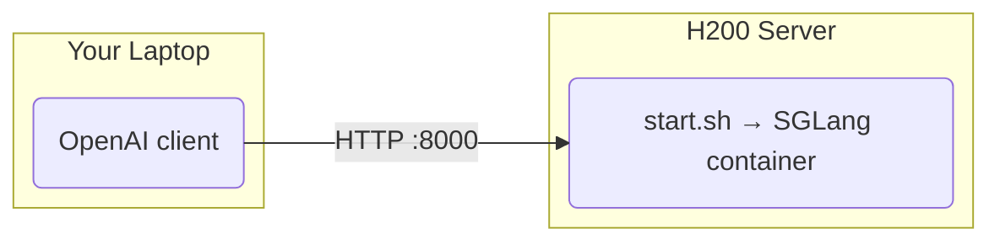

# Qwen3.8-27B on SGLang (2x H200)

One-command SGLang deployment of [Qwen/Qwen3.8-27B](https://huggingface.co/Qwen/Qwen3.8-27B), serving an OpenAI-compatible API.

Recipe: [SGLang Qwen3.8-27B cookbook](https://docs.sglang.io/cookbook/autoregressive/Qwen/Qwen3.8-27B) (H200 cell).

## Architecture



## Server Deployment

Requires Docker + NVIDIA Container Toolkit on the server.

```bash
./install_docker.sh   # one-time; skips anything already installed
cp .env.sample .env   # optional; edit overrides
./start.sh            # streams the boot log, returns once /v1/models answers
./stop.sh
```

First boot downloads ~55GB of BF16 weights into `~/.cache/huggingface` (override with `HF_CACHE`).

### Parallelism

| `GPU_ID` | Layout | Notes |
|----------|--------|-------|
| `0,1` (default) | TP2 | More KV cache, lower per-token latency |
| `0` | TP1 | Cookbook's single-GPU H200 cell |

Other GPU counts are rejected at start.

```bash
GPU_ID=0 ./start.sh   # 1-GPU mode
```

### Settings (`.env` or shell env)

| Variable | Default | Description |
|----------|---------|-------------|
| `GPU_ID` | `0,1` | GPUs passed to the container |
| `HOST` / `PORT` | `0.0.0.0` / `8000` | API bind address |
| `MODEL_ID` | `Qwen/Qwen3.8-27B` | `Qwen/Qwen3.8-27B-FP8` also works on H200 (NVFP4 does not: no FP4 cores) |
| `SERVED_MODEL_NAME` | `Qwen3.8-27B` | `model` name clients send |
| `IMAGE` | `lmsysorg/sglang:v0.5.21` | Cookbook validated on v0.5.19+ |
| `MEM_FRACTION` | `0.85` | `--mem-fraction-static` |
| `MTP` | `0` | `1` = speculative decoding with the in-checkpoint MTP head |
| `HF_CACHE` | `~/.cache/huggingface` | Host model cache |
| `HF_TOKEN` | unset | Optional (public model) |
| `EXTRA_ARGS` | unset | Extra SGLang flags, appended last |

Thinking is on by default. `--reasoning-parser qwen3` returns it in `reasoning_content`. To turn it off per request, send `"chat_template_kwargs": {"enable_thinking": false}`. Tool calling uses `--tool-call-parser qwen3_coder`. Send `tools` in the request; no extra flag is needed.

Native context is 262,144 tokens. For up to 1M with YaRN (static scaling, which can hurt short prompts), see the model card's "Processing Ultra-Long Texts" section. Then pass `--json-model-override-args ... --context-length 1000000` via `EXTRA_ARGS` and set `SGLANG_ALLOW_OVERWRITE_LONGER_CONTEXT_LEN=1` in the container.

MTP (`MTP=1`): EAGLE with 3 steps, topk 1 and 4 draft tokens, using the MTP head that ships in the checkpoint. No extra download is needed. With spec decoding on, SGLang caps `--max-running-requests` at 48. Raise it with `EXTRA_ARGS` if you need more concurrency.

## Test

```bash
curl http://localhost:8000/v1/chat/completions -H "Content-Type: application/json" \
  -d '{"model": "Qwen3.8-27B", "messages": [{"role": "user", "content": "Who won the world series in 2020?"}]}'
```

## Files

- `install_docker.sh`: installs Docker + NVIDIA Container Toolkit (on the H200 host)
- `start.sh` / `stop.sh`: run and stop the SGLang server (on the H200 host)
- `.env.sample`: optional overrides for `start.sh`
